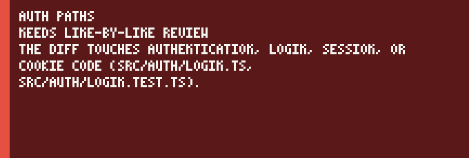

# Agent PR triage

This action reads a pull request and decides whether a coding agent wrote it and whether a person should read the diff line by line. It applies one label and one short comment, or it leaves the pull request alone. It does not call a model. It does not call a paid API. It does not need a secret beyond the workflow token.

## Add the action

```yaml
name: Agent PR triage
on:
  pull_request:
    types: [opened, synchronize, reopened, ready_for_review]
permissions:
  pull-requests: write
  issues: write
concurrency:
  group: agent-pr-triage-${{ github.event.pull_request.number }}
  cancel-in-progress: false
jobs:
  triage:
    runs-on: ubuntu-latest
    steps:
      - uses: kamilkaczmareksolutions/agent-pr-triage@v1
        id: triage
```

`pull-requests: write` lets the action post the comment. `issues: write` lets it create and set labels. The workflow token is the default. A pull request from a fork cannot write labels, so this workflow belongs on the base repository.

The concurrency group keeps one run per pull request and does not cancel the run already in progress. Canceling can leave a comment half written.

## Inputs

| Input | Default | What it does |
| --- | --- | --- |
| `github-token` | `${{ github.token }}` | Token used to read the pull request and write the label and comment. |
| `label-needs-review` | `needs line-by-line review` | Label when the rules force a careful read. |
| `label-skim-ok` | `skim ok` | Label when no force fired and the stack is under the threshold. |
| `lines-changed-threshold` | `400` | Added plus deleted lines that count as one large-diff signal. |
| `stack-review-threshold` | `2` | How many stack signals force a line-by-line review. |
| `skip-human` | `true` | Leave a pull request unchanged when it has no coding-agent signal. |
| `include-dependency-bots` | `false` | Classify Dependabot and Renovate. Off, they are left unchanged. |

A positive integer is required for both thresholds. Booleans must be `true` or `false`. The two label names must differ.

## Outputs

| Output | Values |
| --- | --- |
| `decision` | `skip`, `needs line-by-line review`, or `skim ok` |
| `reasons` | The same sentences as the comment, joined with a vertical bar. Empty on skip. |

## How a decision is made

The action reads the author, the pull request body, and every commit message. A coding-agent signal is a public marker for Cursor, Claude Code, GitHub Copilot, Devin, Codex, Aider, OpenHands, Gemini, or Amazon Q, or a generic trailer such as `Assisted-by` or `Generated-by`. The branch name is not a signal. An IDE completion with no marker in the pull request looks like a person, and the action leaves it alone when `skip-human` is true.

Dependabot and Renovate are dependency bots, not coding agents. The action checks that login before it looks for agent markers, so a Claude trailer in a Dependabot body still produces no label. Set `include-dependency-bots` to `true` when you want those pull requests classified.

When the action does classify, three signals force `needs line-by-line review` on their own.

- A path that names authentication, login, oauth, jwt, a session, or a cookie, including a close spelling such as `oauth2`. A rename counts the old path too.
- A secret or credential path, or a private key in the patch.
- A workflow file under `.github/workflows`.

Three other signals stack. Each one counts as 1. The default threshold is 2, so one of them keeps the label `skim ok` and the comment names it. Two or more force a line-by-line review.

- A dependency manifest or lockfile changed.
- Added plus deleted lines reach `lines-changed-threshold`. A large diff alone does not force review.
- Production code changed and no test file changed.

The comment names the signals that fired and up to three paths for each. The action creates a missing label. A later run updates the same comment, marked `<!-- agent-pr-triage -->`, and removes the label that no longer applies. A later skip removes that comment and those labels, and leaves every other comment and label in place.

## Demo



The animation is every fixture in `test/fixtures`, in the order the tests load them. Regenerate both files with `npm run demo`. The same command writes `docs/demo.svg`, which is the same frames stacked on one page.

## Development

```bash
npm ci
npm test
npm run typecheck
npm run build
npm run demo
```

`npm test` runs the rule engine against the fixtures with Node's built-in test runner. `npm run build` writes `dist/index.js`, which is the file the action runs. The action runtime is Node 24.

Topics: `github-action`, `pull-request`, `code-review`, `ai-agents`.
